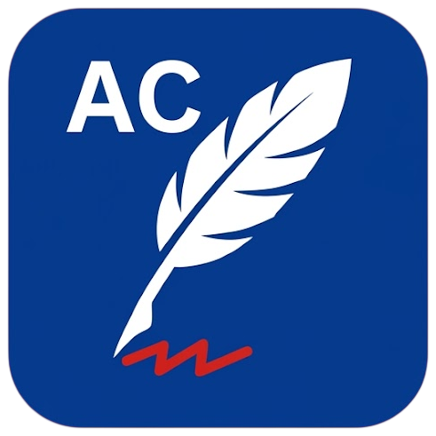

<div align="center">



# AutoCorrect Tray

Typo correction, auto-punctuation and instant translation in any text field on Windows.

[](https://github.com/xdxdsadness/AutoCorrectTray)
[](https://dotnet.microsoft.com/download/dotnet/8.0)
[](LICENSE)

</div>

## About

AutoCorrect Tray is a system-tray utility that works in **any** application - editors, messengers,
browsers, forms. It watches what you type, flags misspelled words right at the caret, fixes
punctuation automatically and translates text in place. It never rewrites your text on its own:
replacements only happen on your click or hotkey.

## Features

- **Spelling hints** - when a misspelled word is finished (space/punctuation), a bubble
  appears at the caret with suggestions; press `1-9` to pick one or add the word to your dictionary.
- **Fix menu on right click** - right-click a misspelled word near the caret to get suggestions;
  a correct word keeps the app's own context menu.
- **Double-click suggestions** - double-click a word to see spelling options.
- **Auto-punctuation** - a period at the end of a sentence on Enter, capital letters for new
  sentences, optional space after punctuation. Every option can be turned off.
- **Translate selection** (`Alt+2`) - translates the selected text in a popup with language pickers,
  *Replace* and *Copy* buttons.
- **Live translation** - with nothing selected, the popup follows what you type and translates it
  as you go; *Replace* prints the translation instead of the original sentence.
- **Region translate** (`Alt+3`) - "scissors without a screenshot": dim the screen, drag a box,
  and every text line inside it is translated **on top of its own line**. Works even where text
  cannot be selected (Windows UI Automation, no OCR). Results are selectable and copyable,
  with one-click *Copy all*.
- **Follows you around** - the translation window follows the monitor you are working on; while it
  is open, new selections are translated automatically.
- **Light/Dark themes, English/Russian UI** - switch instantly in Settings.

## Hotkeys (defaults, fully rebindable)

| Combination | Action |
|---|---|
| `Alt+1` | word fix suggestions at the caret |
| `Alt+2` | translate selected text (opens live mode when nothing is selected) |
| `Alt+3` | translate a selected region ("scissors without a screenshot") |
| `Alt+4` | pause / resume |

Single-key hotkeys (F1-F24, Pause, Scroll Lock) are also allowed. Note: combinations without any
modifier letter (e.g. plain `T`) are rejected on purpose - they would swallow typing system-wide.

## Getting started

### Download

Grab the latest build from
[Releases](https://github.com/xdxdsadness/AutoCorrectTray/releases), unzip and run
`AutoCorrectTray.exe`. The app lives in the system tray - left-click the icon to open Settings.

### Build from source

Requires the [.NET 8 SDK](https://dotnet.microsoft.com/download/dotnet/8.0) (Windows).

```bash
git clone https://github.com/xdxdsadness/AutoCorrectTray.git
cd AutoCorrectTray
dotnet build -c Release
src/AutoCorrectTray/bin/Release/net8.0-windows/AutoCorrectTray.exe
```

### Run tests

```bash
dotnet test
```

## Project structure

```
AutoCorrectTray/
+-- assets/                  # logo sources
+-- docs/                    # architecture notes
+-- src/AutoCorrectTray/
|   +-- Hooks/               # keyboard/mouse hooks, global hotkeys, window focus tracking
|   +-- Input/               # typed-text buffer, key injection (SendInput)
|   +-- Spelling/            # Hunspell (ru+en), language detection
|   +-- Punctuation/         # auto-punctuation rules (pure, unit-tested)
|   +-- TextCapture/         # caret word / selection / region reading via UI Automation
|   +-- Translation/         # Google Translate provider, chunking, language list
|   +-- Ui/                  # popups, region selector, settings, theming, localization
|   +-- Tray/                # tray icon and menu
|   +-- Settings/            # JSON settings, autostart
|   +-- Native/              # Win32 P/Invoke declarations
|   +-- Assets/              # generated logo/icon assets
+-- tests/AutoCorrectTray.Tests/   # xUnit
+-- tools/                   # asset pipeline scripts
```

## Tech stack

| Area | Technology |
|---|---|
| Framework | .NET 8, WPF |
| Spelling | WeCantSpell.Hunspell (ru + en dictionaries) |
| Text access | Windows UI Automation (TextPattern/ValuePattern) |
| Input injection | Win32 `SendInput` |
| Translation | Free Google Translate endpoint (no API key), chunked requests |
| Tray | Hardcodet.NotifyIcon.Wpf |
| Tests | xUnit |

## Documentation

- [Architecture](docs/ARCHITECTURE.md) - how the pieces fit together.

## Contributing

Issues and pull requests are welcome. For bigger changes please open an issue first to discuss
what you would like to change.

## License

Distributed under the [MIT License](LICENSE).

## Acknowledgements

- [WeCantSpell.Hunspell](https://github.com/aaronrobinsonsept/WeCantSpell.Hunspell) - spell checking
- [Hardcodet.NotifyIcon.Wpf](https://github.com/hardcodet/wpf-notifyicon) - tray integration
- Dictionaries from [LibreOffice](https://cgit.freedesktop.org/libreoffice/dictionaries/tree/) (ru/en, see licenses shipped with the app)
